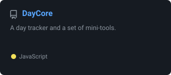

# Hi there! I'm Stas Berchun!

### About Me
Trainee / Junior Full-Stack Developer from Ukraine. Focused on **Python Django** and **JavaScript React**. I am 17 years old and studying Entrepreneurship, Trade, and Stock Exchange Activities in college.
  

<!-- https://spotify-github-profile.kittinanx.com/ -->

### Currently Working On
- Building full-stack To-Do
- Improving my frontend skills with React
- Learning Django REST Framework

### Tech Stack

### Projects

### Goals (next 2-3 years)
- Become a Middle Full-Stack Developer
- Build my own Marketplace

### Let's connect!

